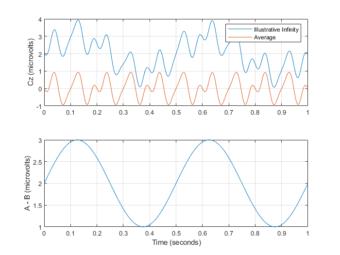

# Synthetic example: Infinity versus Average reference comparison

Download the [repository ZIP with the example and readiness fixes](https://github.com/MPG-Git/QuickLab/archive/refs/heads/main.zip),
extract it to a writable folder, and follow the setup below. The ZIP comes from
main and includes the readiness fixes and example files.
The input files and reference outputs are already included; generation is optional.

This repository is public. You can download the ZIP without a GitHub account.
The extracted demo does not need GitHub credentials to run.

## Run and inspect

This is an EEGLAB plugin example. Copy `QuickLab_11.12.21_NL` into your EEGLAB
`plugins` directory and restart EEGLAB. Keep only one installed QuickLab version.
The example folder travels with the plugin. With EEGLAB initialized, run:

```matlab
pluginRoot = fileparts(which('eegplugin_QuickLab'));
% If your installed hook has a different name, set pluginRoot to the
% QuickLab_11.12.21_NL folder you copied into EEGLAB/plugins.
addpath(fullfile(pluginRoot,'examples','synthetic'));
run_quicklab_demo;
```

Alternatively, from the extracted repository folder:

```matlab
addpath('QuickLab_11.12.21_NL/examples/synthetic');
run_quicklab_demo;
```

Requires MATLAB and EEGLAB (reference run: MATLAB R2023b, EEGLAB 2024.2).
No REST plugin is needed for this illustrative comparison.

The two single-file datasets in `data/` contain 3 channels (Cz, Pz, Fz),
1,000 samples at 250 Hz, and one event. Potentials are in microvolts.
The simulated Infinity data are channel-centered 10/15/20 Hz sinusoids plus
the common term `2 + sin(2*pi*2*t)`. Average referencing subtracts that term.
These are known synthetic potentials, not a REST reconstruction or recorded EEG.

Outputs include `channel_differences.csv`, `comparison.png`, and
`rms_by_channel.png`. A minus B is **Infinity minus Average**. Every channel
must have mean difference 2 microvolts and RMS `sqrt(4.5)` = 2.121320344
microvolts, within 1e-6. The average-reference channel mean must be below 1e-6.
The maximum is about 2.999921 microvolts (the sampled sine misses its exact peak).

For manual use, load both `.set` files with EEGLAB's **File > Load existing dataset**.
Choose **QuickLab > Quick Plots > Other > Plot Last Files Data Differences**.
Select the illustrative Infinity dataset first and Average second. Compare the
RMS chart with `expected/rms_by_channel.png`; use the figure's print/export
controls to save or print it. The command-line runner exercises the same
comparison function, including the EEGLAB plots.



Recreate inputs in a separate folder with `generate_quicklab_data('new_data')`.

## What counts as success

A successful run prints `PASS` and writes `PASS.txt` and `comparison.csv` into
the new output folder. Errors and mismatches stop the runner without a PASS file.
Open the CSV comparison and compare your plots with `expected/`.
The included reference outputs came from actual runs on November 7, 2026.

The default output is this example's `output/` directory. Existing output folders
are refused so a previous result cannot be mistaken for a fresh run. MATLAB
runners accept a new output folder as their first argument (for example,
`run_quicklab_demo('demo_run_2')`).

If a comparison fails, inspect the reported metric and confirm that you used
these bundled files, this repository version, and the listed dependencies.
Do not replace the reference with the failing result. `SHA256SUMS.json` records
input/reference file hashes for download-integrity checks. All input data are
generated; no participant recordings or personal data are included. The supplied
generators refuse to overwrite an existing destination.

These examples check the illustrated installation and workflow, not every menu
item or scientific validity for a particular study. Reference plots may render
differently with another operating system or graphics version.
# ICA and folder practice

## Actual REST / FieldTrip reconstruction

The desktop **Practice data** button also runs `run_rest_demo`. From MATLAB,
with the lab desktop distribution initialized, run `run_rest_demo('new_folder')`
after adding this examples folder to the path. This requires REST, REST_fieldtrip,
DIPFIT and FieldTrip. The standalone QuickLab plugin does not bundle those dependencies.

This separate example generates eight synthetic scalp channels from the REST
three-sphere/3,000-dipole forward model. Native REST and FieldTrip Infinity run
independently on exactly the same leadfield and input samples. Both must recover
the known potentials and agree within 1e-6 microvolts; Infinity must differ from
Average. It writes four `.set` datasets, `rest_metrics.csv`, `rest_comparison.png`
and `PASS.txt`. Bundled reference files are in `rest_example/`. Small floating-point
differences are expected; use the tolerances rather than exact file equality.

For your data, use **QuickLab > Quick Channel Edit > REST / Infinity / Average
(same leadfield)**. It asks which scalp channels to include and adds three
datasets; it never saves over your input. This provides the portable shared-model
workflow from the separate MATLAB REST/Infinity work, not its N3-specific paths
or batch configuration. The forward model is an assumption, not proof that
estimated infinity potentials are the true potentials in a particular recording.

`data/synthetic_rank3.set` is an additional, wholly synthetic four-channel
Average-referenced dataset with known rank three. Load it using the bottom
**Load Folder** button, choose **QuickLab > Quick PCA > ICA**, and expect three
components. Use **Save (+)** with a new filename suffix to save a copy.

The desktop **Practice data** button also runs `run_ica_demo`, producing
synthetic input/output datasets and `ica_metrics.csv`. Compare the component
count and rank with `expected/ica_metrics.csv`; the reconstruction error must
be below `1e-5`. Exact ICA weights, signs and component order need not match.
The Windows desktop bundle includes BINICA; an ordinary standalone plugin
installation can run the MATLAB `runica` example without that executable.

The familiar bottom row reads **Adds to name**, **Save (+)**, **New**, and
**Load Folder**, followed by the available files and navigation arrows.
The ICA information line shows `No; Rank (3)` before ICA and `3; Rank (3)`
afterward. Comparison menu entries appear after two datasets are loaded.

`data/synthetic_rank3FFT.jpg` is the supplied FFT preview for this dataset.
It appears in the right-hand space of the main EEGLAB window when that file
is loaded. Changing to a dataset without a matching picture clears the preview.
Regenerate the picture in a fresh output folder using
`generate_fft_preview(fullfile(pluginRoot,'examples','synthetic','data','synthetic_rank3.set'), outputFolder)`.

## Un-epoch practice (QuickLabMPG 1.2.1)

Load `unepoch_example/synthetic_epoched.set`, then choose **QuickLab > Quick
Epoch edits > UN-Epoch (Back to Continuous)**. Expect a new dataset with eight
channels, one trial, 1,000 samples, and three boundary events. The epoched
original remains in the Datasets menu. Compare with `synthetic_continuous.set`
and `unepoch_metrics.csv` in the same folder. The final sample is at 3.996
seconds; boundary latencies are 250.5, 500.5 and 750.5 samples.

`run_unepoch_demo(outputFolder)` regenerates these files, a continuous REST
result and a boundary plot. It also verifies that REST applied before or after
conversion gives the same potentials (maximum difference below 1e-6 microvolts).
The original REST 1.2 GUI supports both data shapes. Un-epoching joins retained
samples; it cannot reconstruct deleted intervals or the original timeline.

