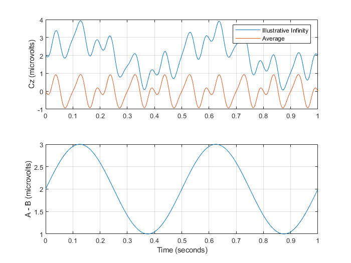

# Synthetic example: Infinity versus Average reference comparison

Download the [repository ZIP with the example and readiness fixes](https://github.com/MPG-Git/QuickLab/archive/refs/heads/codex/readiness-20261107.zip),
extract it to a writable folder, and follow the setup below. These changes are
on the review branch; downloading the older default branch may omit them.
The input files and reference outputs are already included; generation is optional.

## Run and inspect

This is an EEGLAB plugin example. Copy `QuickLab_11.12.21_NL` into your EEGLAB
`plugins` directory and restart EEGLAB. Keep only one installed QuickLab version.
The example folder travels with the plugin. With EEGLAB initialized, run:

```matlab
pluginRoot = fileparts(which('eegplugin_QuickLab'));
% If your installed hook has a different name, set pluginRoot to the
% QuickLab_11.12.21_NL folder you copied into EEGLAB/plugins.
addpath(fullfile(pluginRoot,'examples','synthetic'));
run_quicklab_demo;
```

Alternatively, from the extracted repository folder:

```matlab
addpath('QuickLab_11.12.21_NL/examples/synthetic');
run_quicklab_demo;
```

Requires MATLAB and EEGLAB (reference run: MATLAB R2023b, EEGLAB 2024.2).
No REST plugin is needed for this illustrative comparison.

The two single-file datasets in `data/` contain 3 channels (Cz, Pz, Fz),
1,000 samples at 250 Hz, and one event. Potentials are in microvolts.
The simulated Infinity data are channel-centered 10/15/20 Hz sinusoids plus
the common term `2 + sin(2*pi*2*t)`. Average referencing subtracts that term.
These are known synthetic potentials, not a REST reconstruction or recorded EEG.

Outputs include `channel_differences.csv`, `comparison.png`, and
`rms_by_channel.png`. A minus B is **Infinity minus Average**. Every channel
must have mean difference 2 microvolts and RMS `sqrt(4.5)` = 2.121320344
microvolts, within 1e-6. The average-reference channel mean must be below 1e-6.
The maximum is about 2.999921 microvolts (the sampled sine misses its exact peak).

For manual use, load both `.set` files with EEGLAB's **File > Load existing dataset**.
Choose **QuickLab GUNN > Quick Plots > Other > Plot Last Files Data Differences**.
Select the illustrative Infinity dataset first and Average second. Compare the
RMS chart with `expected/rms_by_channel.png`; use the figure's print/export
controls to save or print it. The command-line runner exercises the same
comparison function, including the EEGLAB plots.



Recreate inputs in a separate folder with `generate_quicklab_data('new_data')`.

## What counts as success

A successful run prints `PASS` and writes `PASS.txt` and `comparison.csv` into
the new output folder. Errors and mismatches stop the runner without a PASS file.
Open the CSV comparison and compare your plots with `expected/`.
The included reference outputs came from actual runs on November 7, 2026.

The default output is this example's `output/` directory. Existing output folders
are refused so a previous result cannot be mistaken for a fresh run. MATLAB
runners accept a new output folder as their first argument (for example,
`run_quicklab_demo('demo_run_2')`).

If a comparison fails, inspect the reported metric and confirm that you used
these bundled files, this repository version, and the listed dependencies.
Do not replace the reference with the failing result. `SHA256SUMS.json` records
input/reference file hashes for download-integrity checks. All input data are
generated; no participant recordings or personal data are included. The supplied
generators refuse to overwrite an existing destination.

These examples check the illustrated installation and workflow, not every menu
item or scientific validity for a particular study. Reference plots may render
differently with another operating system or graphics version.
